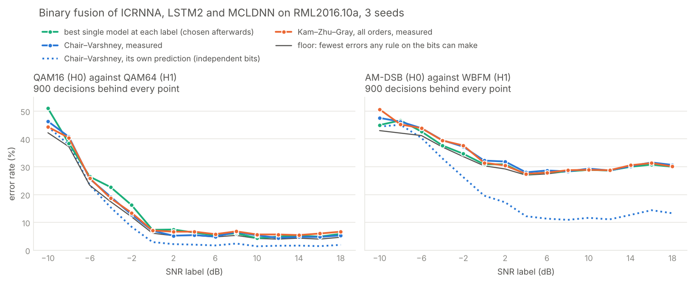

# Binary decision fusion of the 2016 classifiers

The multi-class vote (`VOTE_2016.md`) found that the three best models err on
the same frames. This page asks the binary version of the question, in the
language of distributed detection.

- **The setting.** Three fixed local detectors each send one bit to a fusion
  centre, and the centre decides between two hypotheses.
- **Chair–Varshney (IEEE AES, 1986).** The optimal fusion rule when the bits are
  independent given the hypothesis.
- **Kam–Zhu–Gray (IEEE AES, 1992).** The rule for correlated bits. It writes
  the joint distribution as a Bahadur–Lazarsfeld expansion in the conditional
  correlation coefficients, and reduces to Chair–Varshney when those are zero.

The vote measured an error correlation of about 0.8 between these models, so
they are a natural test case for the second rule.

## Setup

**Data.** No training and no model run. The input is the per-frame decisions
and softmax outputs that `src/vote_fusion.py` saved for ICRNNA, LSTM2 and
MCLDNN: 3 seeds, the same test frames for every model.

**Hypotheses.** Three pairs of classes, each H0 against H1:

| pair | why it is here |
|---|---|
| QAM16 against QAM64 | errors mostly on different frames in the vote |
| AM-DSB against WBFM | errors shared by all three |
| QPSK against 8PSK | an easy pair at high SNR |

Only frames whose true class is one of the pair are used. That gives 900
decisions per SNR label per pair (300 per seed), and 4,500 at labels ≥ 10 dB.

**Local decision.** Model *i* sends u_i = 1 when its softmax output for H1
exceeds its output for H0.

**Rules.** All use equal priors, since the test set is balanced.

| rule | what it does |
|---|---|
| majority | two of three |
| Chair–Varshney | log-likelihood ratio with each detector's P_D and P_F, assuming independence |
| Kam–Zhu–Gray, pairs | the expansion with the pairwise correlations only |
| Kam–Zhu–Gray, all orders | pairs and the triple; for three detectors this is exactly the joint distribution of the 8 bit patterns, which makes it the optimal rule for these bits (`check_expansion()` in the tool verifies the identity) |
| softmax average | the centre receives the scores instead of the bits; a reference, not a bit-fusion rule |

**Estimation, never on the scored frames.**

- P_D, P_F and the correlations are estimated per seed, because each seed is a
  different set of trained models.
- They are estimated per SNR label on half of the frames, the rules are scored
  on the other half, and then the halves swap.
- Above 10 dB the detectors no longer change with SNR, so a second pass pools
  the five labels for estimation. That gives 375 frames per hypothesis per
  estimate instead of 75.

**The floor.** The fewest errors any rule on these bits could make: for each of
the 8 bit patterns, count the smaller of its two class counts. It is fitted to
the frames it scores, so it is optimistic.

**Files.** `tools/binary_fusion.py` writes
`fusion_binary_rml2016_ICRNNA_LSTM2_MCLDNN.json` and figure 39.

## Result above 10 dB

4,500 decisions per pair; rules estimated on the pooled band. The cells are
error rates in %.

| | QAM16 vs QAM64 | AM-DSB vs WBFM | QPSK vs 8PSK |
|---|---|---|---|
| ICRNNA | 7.8 | 30.2 | 0.8 |
| LSTM2 | 5.0 | 29.7 | 1.3 |
| MCLDNN | 8.7 | 32.8 | 0.5 |
| majority | 4.9 | 30.0 | 0.8 |
| Chair–Varshney | 4.9 | 30.1 | 0.8 |
| Kam–Zhu–Gray, pairs | 6.0 | 30.0 | 0.6 |
| **Kam–Zhu–Gray, all orders** | **4.5** | **29.7** | **0.6** |
| softmax average | 4.5 | 29.8 | 0.8 |
| floor | 4.5 | 29.6 | 0.4 |
| *Chair–Varshney's own prediction* | *1.5* | *12.2* | *0.03* |

The detectors that produce those numbers:

| | QAM16 vs QAM64 | AM-DSB vs WBFM | QPSK vs 8PSK |
|---|---|---|---|
| P_D, the three models | 0.91 / 0.94 / 0.89 | 0.40 / 0.41 / 0.36 | 0.99 / 0.98 / 0.99 |
| P_F | 0.07 / 0.05 / 0.07 | 0.003 / 0.003 / 0.013 | 0.009 / 0.014 / 0.009 |
| correlation given H0 | 0.21–0.26 | ≈ 0 | 0.11–0.34 |
| correlation given H1 | 0.37–0.41 | 0.89–0.98 | 0.12–0.32 |

## What the numbers say

**1. No rule gains much here.**

- On every pair, the floor sits within about half a point of the best single
  model:
  4.5 against 5.0, 29.6 against 29.7, 0.4 against 0.5.
- Against ICRNNA alone the QAM pair falls from 7.8% to 4.5%. Most of that drop
  is the centre learning that LSTM2 is the better QAM detector.
- The vote's QAM result in `VOTE_2016.md` has the same reading.

**2. The independence assumption overstates the gain 2.5 to 3 times.**

- Chair–Varshney expects 1.5% on the QAM pair, a third of the floor that no
  rule can beat, and gets 4.9%. On WBFM it expects 12.2% and gets 30.1%.
- On WBFM the cause is plain from the detector table.
  - Each model finds about 40% of the WBFM frames and almost never raises a
    false alarm.
  - All three find the same 40%: the correlation given H1 is 0.9.
  - So the three carry the information of one detector. Chair–Varshney counts it
    three times.

**3. Chair–Varshney's decisions are nearly right; its confidence is not.**

- On the QAM pair it makes 222 errors against the optimal rule's 201. With three
  similar detectors it reduces to the majority, which also makes 222.
- The correlation hardly changes which bit patterns point to which hypothesis.
  What it removes is the gain.

**4. Kam–Zhu–Gray needs data to estimate.**

- **On the pooled band** (375 frames per hypothesis per estimate) the all-orders
  rule reaches the floor on QAM: 201 errors, the same as the floor.
- **Per SNR label** (75 frames) it makes 265, worse than Chair–Varshney's 222.
  - It needs eight cell probabilities per hypothesis, while Chair–Varshney needs
    two numbers per detector.
  - The per-label results are in the JSON under `snr_ge_10`.
- **Stopped at the pairwise terms**, it is worse again: 270 errors on the band,
  298 per label.
  - The truncated expansion is not always a probability.
  - It is ≤ 0 for 23 of 960 (pattern, hypothesis, label, seed) cells on the QAM
    pair and for 87 of 960 on WBFM.
  - There the tool has to clip it.

**5. Fusion pays around and below 0 dB, where errors are less correlated.**

| QAM pair, error % | best single | majority | Kam–Zhu–Gray, all | softmax avg | floor | correlation given H0 / H1 |
|---|---|---|---|---|---|---|
| −4 dB | 22.7 | 19.0 | 18.7 | 20.1 | 17.4 | 0.22–0.30 / 0.27–0.42 |
| −2 dB | 16.2 | 12.8 | 13.4 | 11.3 | 12.0 | 0.17–0.29 / 0.22–0.38 |
| 0 dB | 7.3 | 6.9 | 7.1 | 6.4 | 6.1 | 0.06–0.19 / 0.31–0.54 |

- **At −4 and −2 dB the majority gains 3.4–3.7 points** over the best single
  model. The 11-class vote also gained most from −4 to +2 dB.
- **As SNR rises, the correlation rises.** What is left wrong is the set of
  frames no model can read.
- **On WBFM this is clearest.** The correlation given H1 is 0.21 at −8 dB, 0.60
  at −4, 0.76 at 0, and 0.91–0.93 from +6 dB up.

## What it means

**Correlated, not independent.** As local detectors, these three classifiers
belong to the Kam–Zhu–Gray setting, not the Chair–Varshney one.

- Modelling the dependence brings the predicted performance back to the
  measured one.
- No rule can create information the detectors do not have. Above 10 dB the
  three share almost all of theirs.

**To gain from fusion, the detectors must err on different frames.**

- Three architectures trained on the same IQ frames do not.
- The next test is a detector that looks at something else, such as cumulant
  features or the spectrum. The question is whether its errors decorrelate from
  the networks', and whether fusion then pays.

## Caveats

- **The floor is fitted to the frames it scores.** It is optimistic, so a
  cross-fitted rule can only approach it.
- **"Best single model" is chosen afterwards, per label.** That favours the
  single model over the fusion rules, which choose on held-out frames.
- **The local decision is a choice.** It is the pairwise softmax comparison,
  not the model's 11-class decision.
- **The pairs are a selection.** They were chosen after the vote showed where
  the shared and unshared errors are.
